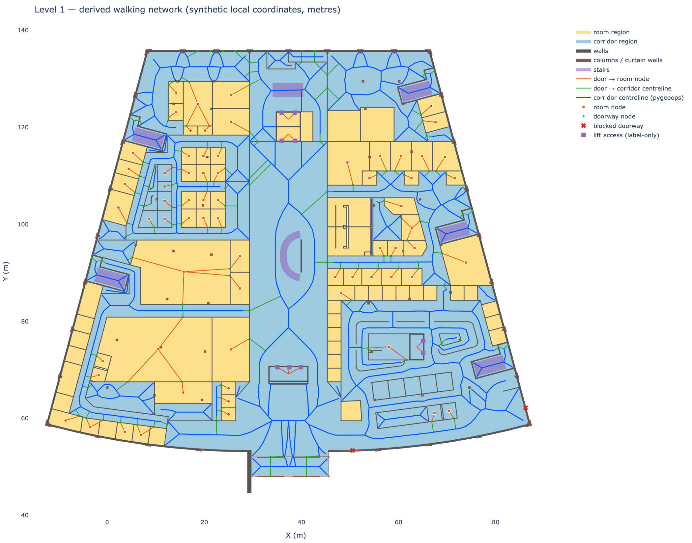
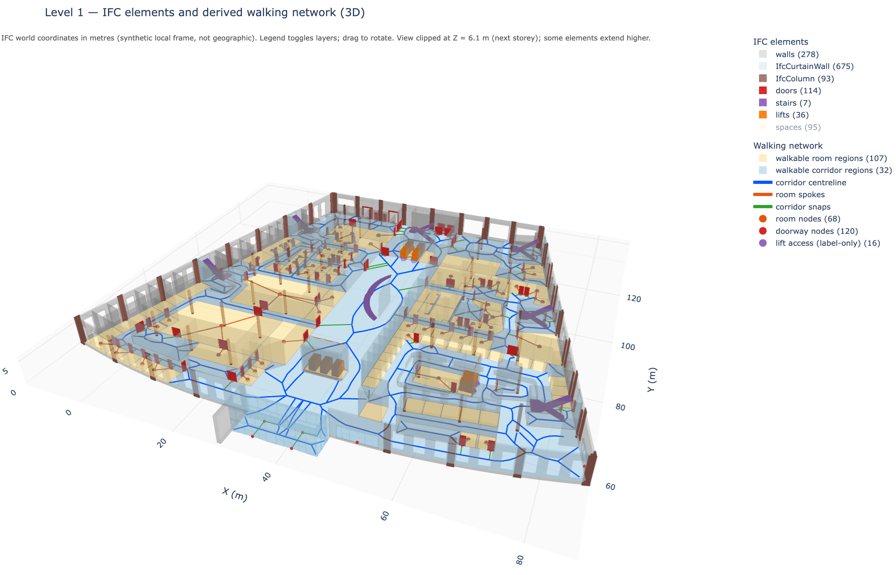

# IFC → indoor walking network (prototype)

Reads an IFC building model, selects one floor by its `IfcBuildingStorey` name, and derives an approximate indoor walking network from the floor's walls, doors and lifts. It uses only IFC labels, properties and explicit relationships. It never invents relationships or geographic coordinates; gaps are reported instead.





## How it works

1. **Inspect** the IFC: schema, units, storeys and element counts. Each element is assigned to a storey only through explicit containment, aggregation, void or fill relationships.
2. **Extract** the walls, doors (with opening → host wall), stairs, columns, curtain walls and lift parts on the selected storey.
3. **Geometry**: IfcOpenShell meshes are projected to 2D Shapely footprints in metres.
4. **Walkable area**: the floor footprint is the area enclosed by the walls and curtain walls. Walls are then subtracted, and only door-filled openings are cut through them (never windows).
5. **Network**: the walkable area is split at the doorways into regions.
   - Rectangular regions become **rooms**, each with one centre node.
   - All other regions become **corridors**, each with a `pygeoops` centreline.
   - Every doorway is connected to the room node or corridor centreline on each side.
6. **Lifts**: there is no `IfcTransportElement` in the sample model. Only proxies named `Elevator_LandingDoor*` are used as lift access, and they are flagged *label-only*.

## Setup

```bash
python3.11 -m venv .venv
.venv/bin/pip install -r ifc_indoor_network/requirements.txt
```

Place the IFC file at `data/20210219Architecture.ifc`, or pass `--ifc`.

## Run

```bash
cd ifc_indoor_network
../.venv/bin/python main.py --storey "Level 1"          # full pipeline
../.venv/bin/python main.py --list-storeys              # inventory only
../.venv/bin/python main.py --storey "Level 2" --no-3d  # skip the 3D view
../.venv/bin/python main.py --export-images             # also write PNGs (needs kaleido + Chrome)
../.venv/bin/python -m pytest -q                        # tests
```

Defaults for the IFC path, storey, tolerances and layers are set in [ifc_indoor_network/config.py](ifc_indoor_network/config.py). Storey names match exactly first, then case-insensitively; use `--storey-id <GlobalId>` if a name is ambiguous.

## Outputs (`ifc_indoor_network/output/`)

The outputs for the sample model's Level 1 are committed, so they can be browsed without re-running the pipeline.

| File | Content |
|---|---|
| `floor_plan.html` | Interactive 2D map (Folium). Click any element for its GlobalId, properties and status; IFC, analysis and network layers can be toggled. |
| `floor_plan_3d.html` | Interactive 3D view (Plotly). Use the legend to filter element types. |
| `inventory.json`, `elements.json` | Model inventory and per-element records (storey membership path, relationships, properties). |
| `geometry_summary.json`, `floor_plan_summary.json`, `network_summary.json`, `connectors_summary.json` | Per-stage results, failures and data-quality flags. |

Coordinates are IFC world X/Y in metres, shown on a blank canvas. They are **synthetic local coordinates, not geographic**.

## Reading the results

- `label_only`: identified by name text, not by IFC entity type. The lift access points are in this category.
- `blocked_doorway`: a door whose opening does not clear all overlapping walls.
- `excluded_placement_inconsistent`: an element placed outside its storey's height range. It is reported but not connected.
- Room and corridor classification is geometric (based on rectangularity and aspect ratio), not taken from IFC labels.

## Sample-model findings (Level 1)

- 118 of 120 doors are connected, all within one network component. 2 external doors are blocked by an overlapping wall that the door opening does not cut.
- The main corridor is not modelled as an `IfcSpace`, so the floor footprint is derived from the wall envelope.
- 9 lift landing doors are connected (label-only). 7 are excluded because they sit at Level 2 height while being contained in Level 1.

Status, decisions and known issues are recorded in [PLAN.md](PLAN.md) and [PROGRESS.md](PROGRESS.md).

## Credits

Sample IFC model (`20210219Architecture.ifc`) from the [Open IFC Model Repository](https://openifcmodel.cs.auckland.ac.nz/), University of Auckland. The model file itself is not included in this repository.
