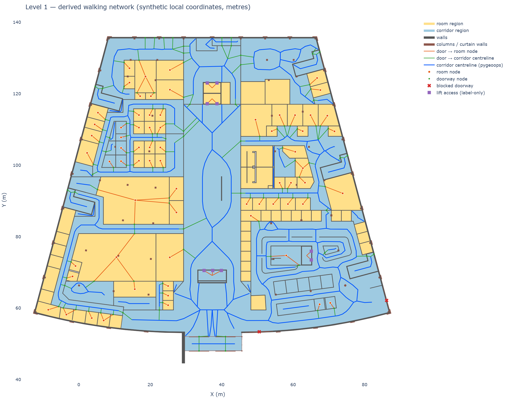
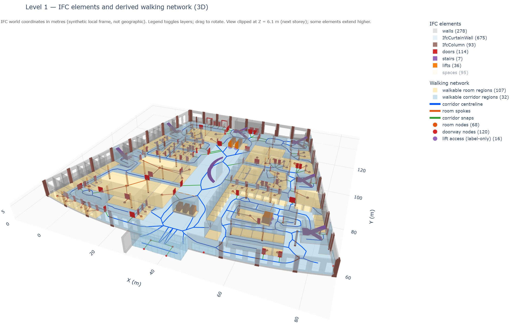
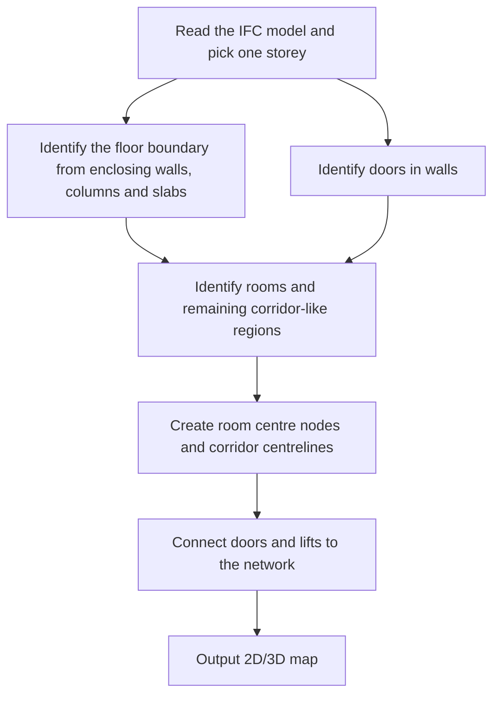

# IFC → indoor walking network (prototype)

Derives an approximate, single-storey pedestrian network from an IFC building model. Storey membership and door-host relationships come from explicit IFC relationships; traversable regions and network connections are **geometrically derived**, not authored IFC relationships.

This is a visual-inspection prototype, not a validated routing, accessibility or means-of-escape analysis tool. Lift access identified from labels remains explicitly flagged; geographic coordinates are not inferred.

## How the walkable area is determined

Think of a floor plan with walls and columns shaded in, and doorways left open. The remaining floor area is the estimated **walkable area**.

1. **Choose the storey and analysis height.** Use the storey's world-placement Z plus 1 m by default.
2. **Find obstacles.** Include **every wall** on the storey, whatever its height, plus curtain walls and columns whose mesh Z range spans the analysis height. Project their geometry onto the XY plane.
3. **Estimate the floor boundary.** Combine the area enclosed by those elements with slabs classified as `FLOOR` or `BASESLAB`.
4. **Leave door passages open.** Cut eligible door openings from their related host, then subtract the remaining obstacles from the floor boundary. Remove small or very thin leftover pieces.

**The Z check is a height filter, not a horizontal section cut.** Included elements are projected in full. Walls are meshed without opening subtraction, then only eligible door passages are cut back in. A horizontal slice could also open windows with low sills, incorrectly treating them as routes. Floor slabs are not height-filtered.

**Walls block at any height (conservative).** On split-level storeys, such as areas at different elevations joined by a ramp, the walls between levels may not span the single analysis height, yet you cannot walk across them. So every wall assigned to the storey is treated as an obstacle, and its door-filled openings are cut at any height. The cost is that bulkheads above the floor and downstands below it also block, which can split the network (observed on split-level validation storeys). Switch this off with `WALLS_BLOCK_AT_ANY_HEIGHT` in `config.py`.





## Extraction flow



Each processing stage writes a JSON inventory or summary; see [Outputs](#outputs). `--list-storeys` stops after the inventory. There is one walkable-area calculation, with eligible door passages included.

### Method and terminology

In plain terms:

- **Read the model:** identify which building elements belong to the selected storey.
- **Draw the floor plan:** estimate the floor boundary and remove obstacles, leaving door passages.
- **Sketch walking lines:** put a centre point in each compact, rectangular region; draw centrelines through the remaining regions.
- **Join them at doors:** connect doorway points to those centres or lines. Connect eligible lift landing doors to the nearest region outside the lift shaft (a region mostly made of lift parts is skipped, as it would not join the main network).

Here, **footprint** means an element's plan projection; **analysis footprint** means the estimated floor boundary. **Room-like** and **corridor-like** describe region shapes, not the rooms' intended uses. A **connector** is a short line joining an access point to the network.

<details>
<summary>Detailed processing rules</summary>

| Stage | Implemented logic |
|---|---|
| **Semantic extraction** | Resolve storey membership upwards through containment, aggregation, nesting, voiding and filling relationships; retain the traversed path. Extract walls, slabs, spaces, doors, openings, stairs, stair flights, configured obstacles and lift candidates. Preserve IDs, labels, selected properties and relationship references. Wall classification uses `Pset_WallCommon.IsExternal`; absent values remain `unknown`. |
| **Plan geometry** | IfcOpenShell applies nested placements and outputs meshes in world coordinates, in metres. Union projected mesh triangles into XY footprints; repair invalid polygonal geometry where needed. Curtain-wall parts contribute footprints when they span walking height. This is a **projection**, not a horizontal section. |
| **Analysis footprint** | Union walls (at any height, see above), plus curtain walls and columns spanning walking height; apply envelope closing and fill their outer rings. Union this with footprints of slabs classified `FLOOR` or `BASESLAB`. Use either source alone if necessary; if neither is available, report the footprint as unavailable. `IfcSpace` footprints are comparison/display data, not the analysis boundary. |
| **Walkable area** | Subtract walls and configured obstacles from the analysis footprint after applying door cuts. Each cut affects **only its explicitly related host**; it does not clear overlapping obstacles. Remove small and thin polygon components, logging the removals. |
| **Door cuts** | Use an `IfcDoor` filling an `IfcOpeningElement` via `IfcRelFillsElement`, with its host established by `IfcRelVoidsElement`; the opening must span walking height, unless `WALLS_BLOCK_AT_ANY_HEIGHT` is on (the default), in which case any height is accepted. A fixed exception uses the door footprint when the door is aggregated in an `IfcCurtainWall`. Window-filled and unfilled openings never create passages. |
| **Network regions** | Remove door-cut polygons from the walkable area to separate regions. Classify a region as `room` when area / minimum-rotated-rectangle area ≥ 0.85 and rectangle aspect ratio ≤ 3; otherwise classify it as `corridor`. These are **geometric classes**, not IFC space-use classifications. |
| **Nodes and centrelines** | A room-like region gets its centroid, or a point-on-surface if the centroid is outside the polygon. Corridor-like regions first lose every part narrower than 1 m (a morphological opening), so centrelines never pass through gaps under 1 m clear width; corridors narrower than 1 m everywhere get no centreline. `pygeoops.centerline` then runs on what remains. Tight loops around columns and posts (enclosing < 20 m²) keep one side only. Leaf branches running within 1.5 m alongside another branch (fans in open spaces with jagged edges) are removed. Short leaf forks into corners and corridor ends are pruned (leaf shorter than 1.5 × the local half-width, only where the half-width is ≤ 4 m), leaving one line along the corridor axis. Wide halls keep their branches so side doors stay reachable. Failed, empty or fragmented centrelines are reported. |
| **Door connections** | An open doorway's access point is the centroid of the cut intersected with walkable area. Regions within the cut-adjacency tolerance receive straight connectors to their room node or nearest corridor centreline. A door without a usable cut does not enter this connection stage. |
| **Lift access** | Inventory `IfcTransportElement` instances and label-based candidates separately. Only names matching `^Elevator_LandingDoor` qualify as access candidates, regardless of entity type. Connect each eligible footprint centroid to its nearest adjacent region; exclude candidates with inconsistent placement Z. Label-based identification stays `label_only`. |
| **Connectivity and display** | Compute components from touching centrelines and accepted connectors. Display IFC, analysis and network layers in Folium; optionally overlay the same derived network on separately meshed IFC geometry in Plotly. The 3D display subtracts IFC openings, unlike the solid meshes used for plan analysis. |

Implementation: [semantic extraction](ifc_indoor_network/ifc_reader.py), [geometry and walkable area](ifc_indoor_network/geometry_processing.py), [network and connectors](ifc_indoor_network/network_generation.py), [visualisation](ifc_indoor_network/visualisation.py), [pipeline and CLI](ifc_indoor_network/main.py).

</details>

### Assumptions and limitations

| Topic | Interpretation / consequence |
|---|---|
| **Storey membership** | Geometry never assigns or reassigns membership. Unresolved elements remain unassigned; additional storey references are recorded but do not extend extraction membership. A wall spanning several storeys may therefore be absent from upper-storey analysis if it belongs only to its base storey. |
| **Units and datum** | Convert IFC length attributes using the project's unit scale; mesh coordinates are already metres. Walking height is storey world-placement Z + 1 m. Without a placement, the code falls back to `Elevation`, then zero; this fallback does not establish a reliable world datum. |
| **2D approximation** | Walls are taken at any height (conservative; see above). Curtain walls and columns are selected by mesh Z extents spanning walking height. All are projected in full, not sliced. Slab candidates are **not filtered by height**. The analysis footprint can include slab overhangs/balconies or slabs at other elevations; filling envelope rings can include courtyards/voids. It is not a verified usable floor-area boundary. |
| **Obstacle coverage** | Default obstacles are walls, curtain walls and columns. Railings, furniture, stairs and other proxies are not subtracted by default. No pedestrian-clearance buffer or minimum passage-width test is applied; component mean-width filtering is not a clearance check. |
| **Topology and room use** | Missing door/host relationships are not inferred. Non-rectangular rooms may be classified as corridors. Geometric adjacency and straight connectors are analytical assumptions, not authored space boundaries or evidence of permitted access. |
| **Connector acceptance** | Corridor snaps longer than `max(3 m, region maximum inscribed radius + 1 m)` are rejected; room spokes have no distance limit. Length crossing non-walkable geometry is measured and reported above 0.01 m, but **does not reject a connector**. Thus `connected` does not guarantee a collision-free route. |
| **Blocked doorways** | Floor-plan diagnostics flag cuts whose obstacle-covered fraction exceeds 0.5. Network generation separately calls a doorway open if any positive walkable cut area remains. A partial obstruction can therefore be reported as blocked in the floor-plan summary yet receive a network connection. |
| **Vertical circulation** | Stairs are extracted/displayed; lift access is connected only within the selected storey. No inter-storey links, lift operation, travel times, access-control rules or route solver are implemented. |
| **Coordinates and diagnostics** | Outputs use the IFC local coordinate frame (no geographic CRS). Stage-level summaries exist; the consolidated diagnostics report and acceptance review remain pending. |

## Setup

From the repository root, create the environment once using Python 3.11:

```powershell
python -m venv .venv
```

Activate it in each new terminal, then install dependencies:

```powershell
# Windows PowerShell
.\.venv\Scripts\Activate.ps1
pip install -r .\ifc_indoor_network\requirements.txt
```

```bash
# macOS / Linux
source .venv/bin/activate
pip install -r ifc_indoor_network/requirements.txt
```

Pass the IFC file explicitly with `--ifc` on every run; there is no default input file. Relative paths are resolved from the terminal's working directory.

## Run

```bash
cd ifc_indoor_network
python main.py --ifc "data/20210219Architecture.ifc" --storey "Level 1"
python main.py --ifc "data/20210219Architecture.ifc" --list-storeys
python main.py --ifc "data/20210219Architecture.ifc" --storey "Level 2" --no-3d
python -m pytest -q
```

Storey names match exactly first, then case-insensitively; use `--storey-id <GlobalId>` if a name is ambiguous.

The examples assume the sample is in `ifc_indoor_network/data/`; replace the path for another model. Use `--output-dir <directory>` to keep runs separate. Settings you may want to change for another model (target storey, obstacle classes, lift naming, walking height, clear width, room rule, gap closing, minimum area, 3D categories) are in [config.py](ifc_indoor_network/config.py), each with a note on when to change it. Tuned internals (corridor shaping, geometry tolerances, snap limits, Revit specifics) are hard-coded in [heuristics.py](ifc_indoor_network/heuristics.py) and are not meant to be edited per model. Only `--storey`, `--storey-id` and `--output-dir` override settings on the command line. Run `python main.py --help` for the CLI reference.

## Outputs

Default destination: [ifc_indoor_network/output/](ifc_indoor_network/output/).

The outputs for the sample model's Level 1 are committed, so they can be browsed without re-running the pipeline.

| File | Content |
|---|---|
| `floor_plan.html` | Standalone, offline interactive 2D map (Folium). The header shows the source IFC file, storey and run time. Click a region for its IFC room label (`ifc_space`), `region_id`, `kind` and `area_m2`; click IFC elements for name, GlobalId and class. Toggle the layers that carry the processing logic (walls, columns/curtain walls, doors, door cuts, walkable area, regions, centrelines, connectors, nodes). `ifc_space` is the label (LongName, else Name) of the IfcSpace covering at least half of the region; it is a display-only hint from geometric overlap, not used for storey membership or network logic. |
| `floor_plan_3d.html` | Standalone, offline interactive 3D view (Plotly; plotly.js embedded, ~4.6 MB overhead). Use the legend to filter element types. |
| `inventory.json` | Model inventory. |
| `summary.json` | One file with the per-stage results (`extraction`, `geometry`, `floor_plan`, `network`, `connectors`), failures and data-quality flags. |

The images under `docs/images/` are static screenshots of the Level 1 sample; the pipeline does not write PNGs.

Coordinates are IFC world X/Y in metres, shown on a blank canvas.

Open `floor_plan.html` directly in a browser, even without an internet connection.
Its JavaScript, styles and control images are embedded; copying just this HTML file
is sufficient. Future 2D exports also work offline, using the pinned assets and
licenses in [ifc_indoor_network/vendor/](ifc_indoor_network/vendor/) without downloads
at generation time. `floor_plan_3d.html` is also standalone: plotly.js is embedded
from the installed `plotly` package.

## Reading the results

- `label_only`: identified by name text, not by IFC entity type. The lift access points are in this category.
- `blocked_doorway`: a processed door cut with no remaining walkable area; distinct from the floor-plan covered-fraction diagnostic.
- `connected` / `connected_one_side`: accepted connectors to at least two / one adjacent region, respectively; not a clearance or access-permission guarantee.
- `excluded_placement_inconsistent`: a lift-access candidate outside the placement-Z window. It is reported but not connected; other categories retain report-only placement flags.
- Doors without usable cuts are listed in `summary.json` under `floor_plan.doors_without_cut`, not counted as connected or unconnected in the connector-stage door totals.
- Room and corridor classification is geometric (based on rectangularity and aspect ratio), not taken from IFC labels.
- A storey with no supported elements resolved through explicit IFC relationships
  produces no walking network. Its 3D view displays a "No displayable geometry"
  notice instead of inventing geometry; inspect `summary.json` (`extraction`, `floor_plan`)
  for the extraction counts and footprint availability.

## Sample-model findings (Level 1)

Historical results for `20210219Architecture.ifc`, not guarantees for other models. The sample integration tests run against `ifc_indoor_network/data/` when it is present.

- 118 of 120 doors are connected, all within one network component. 2 external doors are blocked by an overlapping wall that the door opening does not cut.
- The main corridor is not modelled as an `IfcSpace`, so the floor footprint is derived from the wall envelope.
- 9 lift landing doors are connected (label-only). 7 are excluded because they sit at Level 2 height while being contained in Level 1.

Status, decisions and known issues are recorded in [PLAN.md](PLAN.md) and [PROGRESS.md](PROGRESS.md).

## Credits

Sample IFC model (`20210219Architecture.ifc`) from the [Open IFC Model Repository](https://openifcmodel.cs.auckland.ac.nz/), University of Auckland. The model file itself is not included in this repository.
